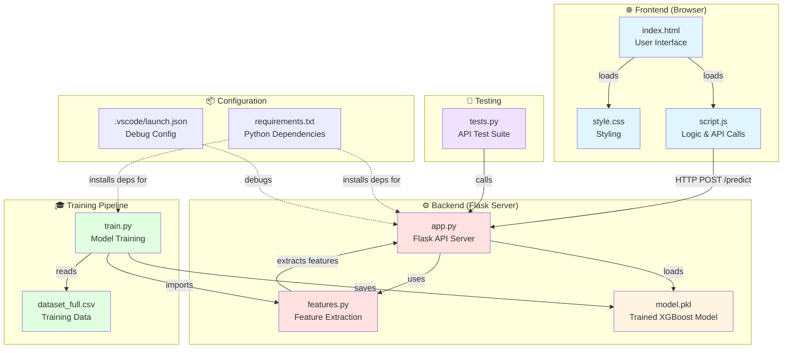
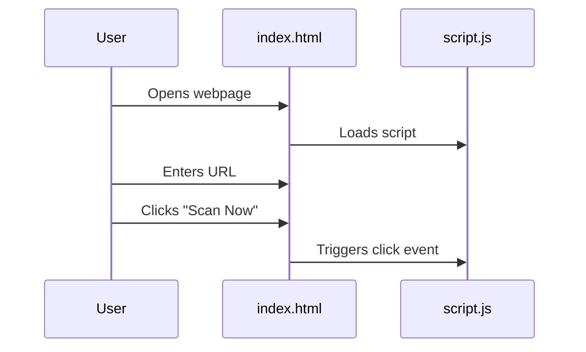
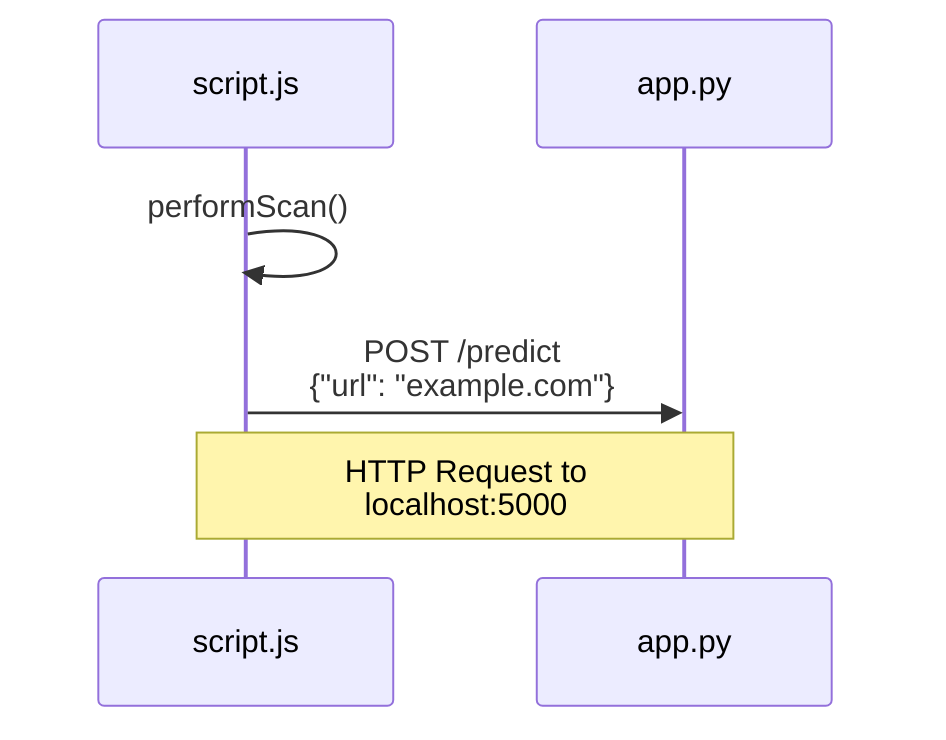
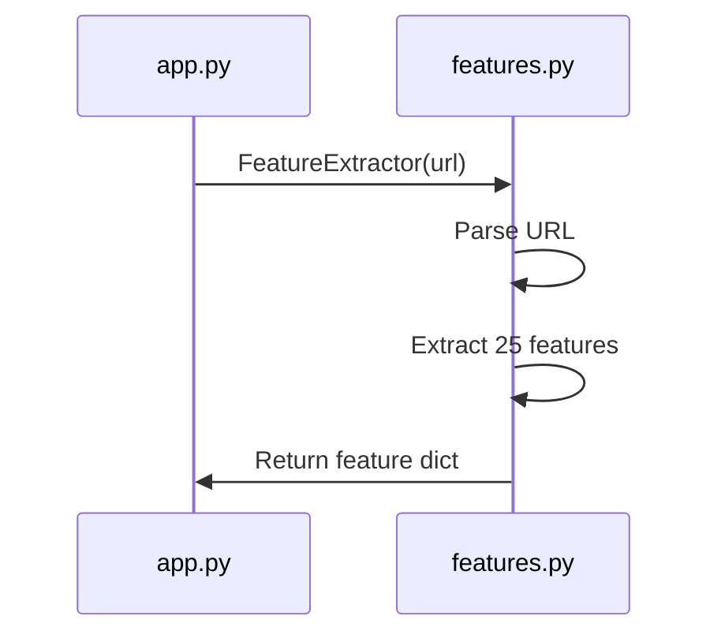
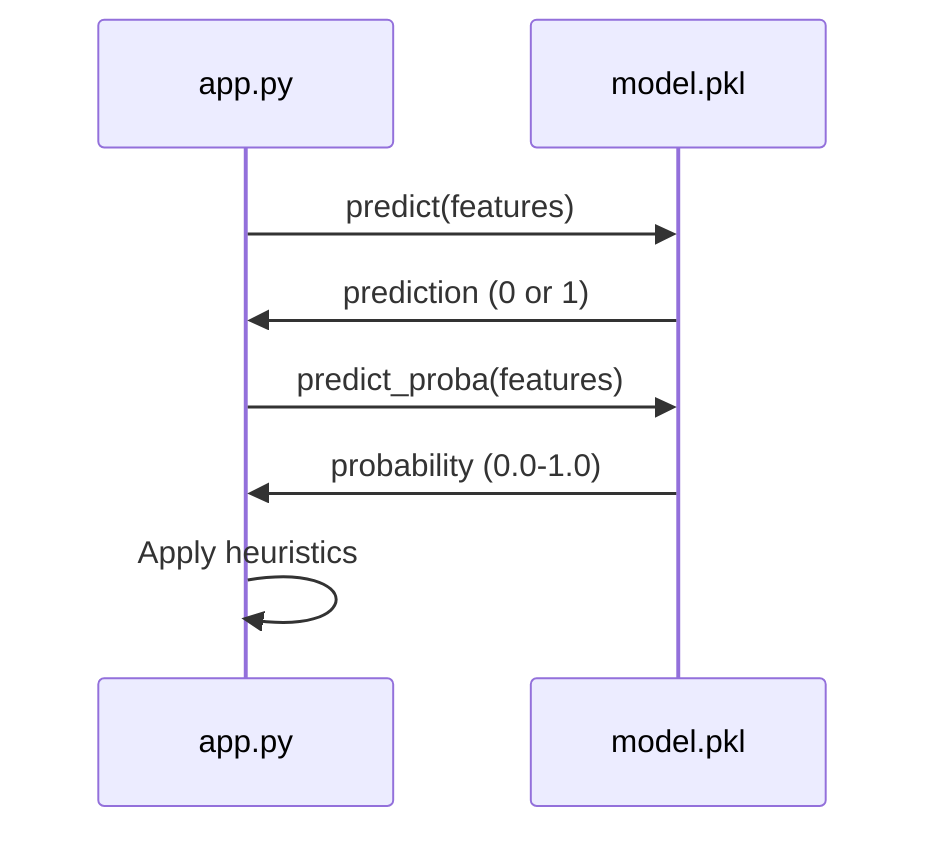
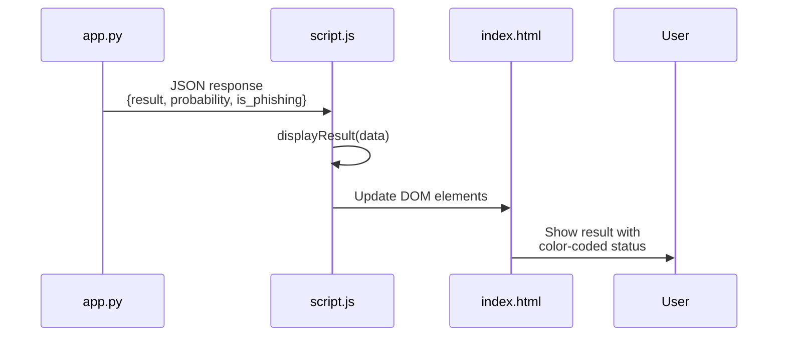
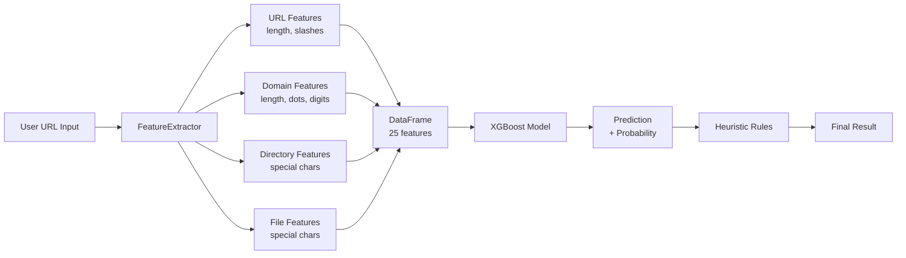

# Phishing Detection System - Architecture Overview

## 🏗️ System Architecture

This document explains how all files in the Phishing Detection System are connected and work together.



---

## 📁 File Connections & Data Flow

### **1. Frontend Layer** 🌐

#### [index.html](file:///d:/Phishing%20Websites%20Detection/frontend/index.html)
- **Purpose**: User interface structure
- **Connections**:
  - Links to [style.css](file:///d:/Phishing%20Websites%20Detection/frontend/style.css) for styling
  - Links to [script.js](file:///d:/Phishing%20Websites%20Detection/frontend/script.js) for functionality
  - Includes Font Awesome for icons
- **Key Elements**:
  - URL input field (`#urlInput`)
  - Scan button (`#scanBtn`)
  - Result display container (`#resultContainer`)

#### [style.css](file:///d:/Phishing%20Websites%20Detection/frontend/style.css)
- **Purpose**: Visual styling and animations
- **Features**:
  - Modern gradient backgrounds
  - Responsive design
  - Status indicators (safe/phishing)
  - Loading animations

#### [script.js](file:///d:/Phishing%20Websites%20Detection/frontend/script.js)
- **Purpose**: Frontend logic and API communication
- **Key Functions**:
  - `performScan()`: Sends URL to backend API
  - `displayResult()`: Shows prediction results
- **API Connection**:
  ```javascript
  POST http://127.0.0.1:5000/predict
  Body: { "url": "example.com" }
  ```
- **Response Handling**:
  - Displays phishing/safe status
  - Shows confidence score
  - Updates UI with color-coded results

---

### **2. Backend Layer** ⚙️

#### [app.py](file:///d:/Phishing%20Websites%20Detection/backend/app.py)
- **Purpose**: Flask REST API server
- **Port**: 5000
- **Endpoints**:
  - `POST /predict`: Analyzes URLs for phishing
- **Dependencies**:
  - Imports `FeatureExtractor` from [features.py](file:///d:/Phishing%20Websites%20Detection/backend/features.py)
  - Loads trained model from [model.pkl](file:///d:/Phishing%20Websites%20Detection/backend/model.pkl)
- **Workflow**:
  1. Receives URL from frontend
  2. Extracts features using `FeatureExtractor`
  3. Predicts using XGBoost model
  4. Applies heuristic rules:
     - **Typosquatting detection**: Flags domains with suspicious digits (e.g., `micros0ft.com`)
     - **Homepage heuristic**: Trusts clean homepages
     - **Reputation hijacking**: Flags abused legitimate domains (Google Docs, Dropbox)
  5. Returns JSON response with prediction and probability

#### [features.py](file:///d:/Phishing%20Websites%20Detection/backend/features.py)
- **Purpose**: URL feature extraction
- **Class**: `FeatureExtractor`
- **Used By**:
  - [app.py](file:///d:/Phishing%20Websites%20Detection/backend/app.py) (prediction)
  - [train.py](file:///d:/Phishing%20Websites%20Detection/backend/train.py) (training)
- **Extracted Features** (25 total):
  - **URL features**: length, slash count
  - **Domain features**: length, dots, vowels, digits
  - **Directory features**: length, special characters
  - **File features**: length, special characters
- **Methods**:
  - `extract()`: Returns feature dictionary
  - `get_feature_names()`: Returns feature list (ensures consistency)

#### [model.pkl](file:///d:/Phishing%20Websites%20Detection/backend/model.pkl)
- **Purpose**: Serialized XGBoost classifier
- **Created By**: [train.py](file:///d:/Phishing%20Websites%20Detection/backend/train.py)
- **Loaded By**: [app.py](file:///d:/Phishing%20Websites%20Detection/backend/app.py)
- **Size**: ~309 KB
- **Algorithm**: XGBoost with 100 estimators

---

### **3. Training Pipeline** 🎓

#### [train.py](file:///d:/Phishing%20Websites%20Detection/backend/train.py)
- **Purpose**: Train the XGBoost model
- **Workflow**:
  1. Loads [dataset_full.csv](file:///d:/Phishing%20Websites%20Detection/backend/dataset_full.csv)
  2. Imports feature names from [features.py](file:///d:/Phishing%20Websites%20Detection/backend/features.py)
  3. Trains XGBoost classifier
  4. Evaluates accuracy and classification report
  5. Saves model to [model.pkl](file:///d:/Phishing%20Websites%20Detection/backend/model.pkl)
- **Run Command**:
  ```bash
  python backend/train.py
  ```

#### [dataset_full.csv](file:///d:/Phishing%20Websites%20Detection/backend/dataset_full.csv)
- **Purpose**: Training dataset
- **Size**: ~25 MB
- **Contains**: Pre-extracted features and labels
- **Target Column**: `phishing` (0 = legitimate, 1 = phishing)

---

### **4. Testing** 🧪

#### [tests.py](file:///d:/Phishing%20Websites%20Detection/backend/tests.py)
- **Purpose**: Automated API testing
- **Tests**:
  - Scheme-less URL handling
  - Typosquatting detection
  - Homepage heuristics
  - Reputation hijacking
  - Known phishing patterns
- **Connects To**: [app.py](file:///d:/Phishing%20Websites%20Detection/backend/app.py) API
- **Run Command**:
  ```bash
  python backend/tests.py
  ```

---

### **5. Configuration** 📦

#### [requirements.txt](file:///d:/Phishing%20Websites%20Detection/backend/requirements.txt)
- **Purpose**: Python dependencies
- **Packages**:
  - `Flask` - Web server
  - `flask-cors` - Cross-origin requests
  - `scikit-learn` - ML utilities
  - `xgboost` - Model algorithm
  - `pandas` - Data manipulation
  - `joblib` - Model serialization
  - `requests` - HTTP testing
- **Install Command**:
  ```bash
  pip install -r backend/requirements.txt
  ```

#### [.vscode/launch.json](file:///d:/Phishing%20Websites%20Detection/.vscode/launch.json)
- **Purpose**: VS Code debugging configuration
- **Enables**: Debugging [app.py](file:///d:/Phishing%20Websites%20Detection/backend/app.py) with breakpoints

---

## 🔄 Complete Data Flow

````carousel
### Step 1: User Interaction


<!-- slide -->

### Step 2: API Request


<!-- slide -->

### Step 3: Feature Extraction


<!-- slide -->

### Step 4: Prediction


<!-- slide -->

### Step 5: Response & Display

````

---

## 🚀 How to Run the System

### **Start Backend Server**
```bash
cd "d:\Phishing Websites Detection"
python backend/app.py
```
Server runs on `http://127.0.0.1:5000`

### **Open Frontend**
Open `frontend/index.html` in a web browser

### **Test the System**
```bash
python backend/tests.py
```

---

## 🔧 Key Integration Points

| Component | Connects To | Connection Type | Purpose |
|-----------|-------------|-----------------|---------|
| `script.js` | `app.py` | HTTP POST | Send URL for analysis |
| `app.py` | `features.py` | Python import | Extract URL features |
| `app.py` | `model.pkl` | File load | Make predictions |
| `train.py` | `features.py` | Python import | Get feature names |
| `train.py` | `dataset_full.csv` | File read | Load training data |
| `train.py` | `model.pkl` | File write | Save trained model |
| `tests.py` | `app.py` | HTTP POST | Validate API |

---

## 📊 Feature Flow



---

## 🎯 Summary

The system follows a **3-tier architecture**:

1. **Frontend** (`index.html`, `style.css`, `script.js`): User interface
2. **Backend** (`app.py`, `features.py`, `model.pkl`): API and ML inference
3. **Training** (`train.py`, `dataset_full.csv`): Model development

**Core workflow**: User → Frontend → API → Feature Extraction → ML Model → Heuristics → Response → UI Update

All components are loosely coupled, making the system maintainable and scalable.
