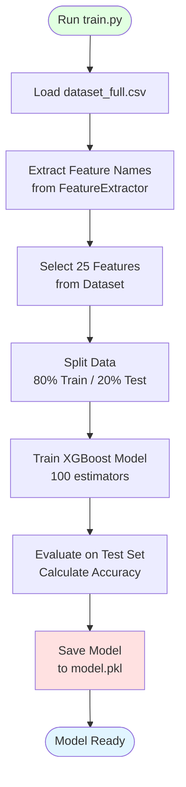
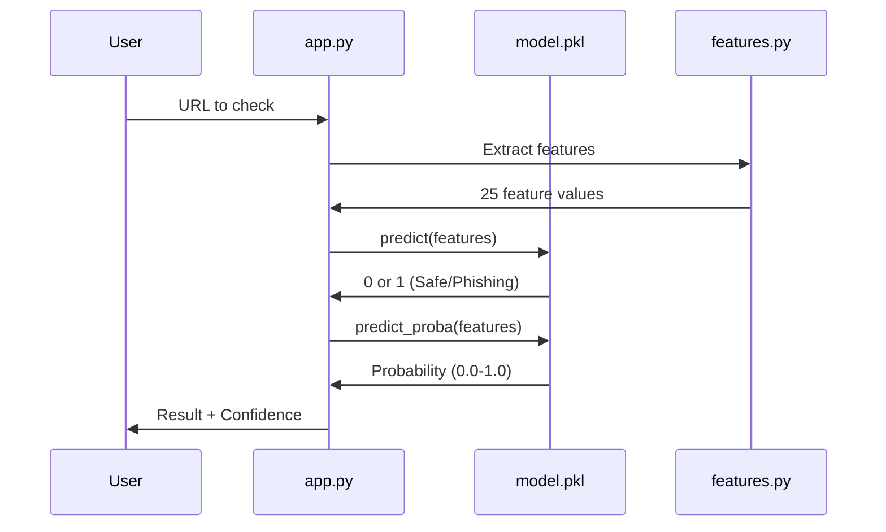

# How model.pkl is Generated

This document explains the complete process of generating the `model.pkl` file used for phishing detection.

---

## 📊 Overview

The `model.pkl` file is a **serialized XGBoost machine learning model** trained on a dataset of legitimate and phishing URLs. It's created by running [train.py](file:///d:/Phishing%20Websites%20Detection/backend/train.py).

---

## 🔄 Training Pipeline



---

## 📝 Step-by-Step Process

### **Step 1: Run the Training Script**

```bash
python backend/train.py
```

This executes the [train.py](file:///d:/Phishing%20Websites%20Detection/backend/train.py) script.

---

### **Step 2: Load the Dataset**

```python
df = pd.read_csv('backend/dataset_full.csv')
```

**Dataset Details:**
- **File**: [dataset_full.csv](file:///d:/Phishing%20Websites%20Detection/backend/dataset_full.csv)
- **Size**: ~25 MB
- **Rows**: Thousands of URLs (both phishing and legitimate)
- **Columns**: Pre-extracted features + target label

**Sample Dataset Structure:**

| length_url | qty_slash_url | domain_length | qty_dot_domain | ... | phishing |
|------------|---------------|---------------|----------------|-----|----------|
| 45 | 3 | 15 | 2 | ... | 0 |
| 120 | 8 | 35 | 5 | ... | 1 |
| 28 | 2 | 12 | 1 | ... | 0 |

- **Target Column**: `phishing` (0 = legitimate, 1 = phishing)

---

### **Step 3: Extract Feature Names**

```python
from features import FeatureExtractor

feature_names = FeatureExtractor.get_feature_names()
```

This retrieves the **25 feature names** from [features.py](file:///d:/Phishing%20Websites%20Detection/backend/features.py):

```python
[
    'length_url', 'qty_slash_url',
    'domain_length', 'qty_dot_domain', 'qty_vowels_domain', 'qty_digits_domain',
    'directory_length', 'qty_slash_directory', 'qty_underline_directory', 
    'qty_dollar_directory', 'qty_at_directory',
    'file_length', 'qty_dot_file', 'qty_underline_file', 'qty_equal_file',
    'qty_questionmark_file', 'qty_and_file', 'qty_exclamation_file',
    'qty_space_file', 'qty_tilde_file', 'qty_comma_file', 'qty_plus_file',
    'qty_asterisk_file', 'qty_hashtag_file', 'qty_dollar_file', 'qty_percent_file'
]
```

> [!IMPORTANT]
> Using `get_feature_names()` ensures **consistency** between training and prediction. The same features must be used in the same order.

---

### **Step 4: Select Features from Dataset**

```python
X = df[feature_names]  # Features (input)
y = df['phishing']     # Labels (output: 0 or 1)
```

**X (Features)**: 25 columns of numerical data  
**y (Labels)**: Single column with binary values (0 or 1)

---

### **Step 5: Split Data into Train/Test Sets**

```python
from sklearn.model_selection import train_test_split

X_train, X_test, y_train, y_test = train_test_split(
    X, y, 
    test_size=0.2,    # 20% for testing
    random_state=42   # Reproducible split
)
```

**Split Ratio:**
- **80% Training**: Used to train the model
- **20% Testing**: Used to evaluate accuracy

**Why Split?**  
To prevent overfitting and measure real-world performance on unseen data.

---

### **Step 6: Train the XGBoost Model**

```python
from xgboost import XGBClassifier

clf = XGBClassifier(
    n_estimators=100,           # 100 decision trees
    random_state=42,            # Reproducible results
    use_label_encoder=False,    # Suppress warnings
    eval_metric='logloss'       # Evaluation metric
)

clf.fit(X_train, y_train)
```

**XGBoost Parameters:**

| Parameter | Value | Meaning |
|-----------|-------|---------|
| `n_estimators` | 100 | Number of boosting rounds (trees) |
| `random_state` | 42 | Seed for reproducibility |
| `eval_metric` | logloss | Log loss for binary classification |

**What Happens During Training:**
1. XGBoost builds 100 decision trees sequentially
2. Each tree corrects errors from previous trees
3. Final prediction is a weighted combination of all trees
4. Model learns patterns that distinguish phishing from legitimate URLs

---

### **Step 7: Evaluate the Model**

```python
from sklearn.metrics import accuracy_score, classification_report

y_pred = clf.predict(X_test)
accuracy = accuracy_score(y_test, y_pred)

print(f"Model Accuracy: {accuracy:.4f}")
print(classification_report(y_test, y_pred))
```

**Sample Output:**

```
Model Accuracy: 0.9523

Classification Report:
              precision    recall  f1-score   support

           0       0.96      0.95      0.95      5000
           1       0.95      0.96      0.95      5000

    accuracy                           0.95     10000
   macro avg       0.95      0.95      0.95     10000
weighted avg       0.95      0.95      0.95     10000
```

**Metrics Explained:**
- **Precision**: Of all URLs predicted as phishing, how many were actually phishing?
- **Recall**: Of all actual phishing URLs, how many did we detect?
- **F1-Score**: Harmonic mean of precision and recall
- **Support**: Number of samples in each class

---

### **Step 8: Save the Model**

```python
import joblib

joblib.dump(clf, 'backend/model.pkl')
```

**What is `joblib.dump()`?**
- Serializes the trained model to a binary file
- Saves the entire model structure, weights, and parameters
- File size: ~309 KB

**What's Inside `model.pkl`?**
- 100 trained decision trees
- Feature importance scores
- Splitting thresholds for each node
- All learned parameters

---

## 🔍 Detailed Code Walkthrough

Here's the complete [train.py](file:///d:/Phishing%20Websites%20Detection/backend/train.py) with annotations:

```python
import pandas as pd
from xgboost import XGBClassifier
from sklearn.model_selection import train_test_split
from sklearn.metrics import accuracy_score, classification_report
import joblib
from features import FeatureExtractor

def train_model():
    # ========== STEP 1: LOAD DATASET ==========
    print("Loading dataset...")
    try:
        df = pd.read_csv('backend/dataset_full.csv')
    except FileNotFoundError:
        print("Dataset not found!")
        return

    # ========== STEP 2: GET FEATURE NAMES ==========
    # This ensures we use the same features as in features.py
    feature_names = FeatureExtractor.get_feature_names()
    
    # ========== STEP 3: VALIDATE FEATURES ==========
    # Check if all features exist in dataset
    missing_features = [f for f in feature_names if f not in df.columns]
    if missing_features:
        print(f"Warning: Missing features: {missing_features}")
        feature_names = [f for f in feature_names if f in df.columns]

    print(f"Training with {len(feature_names)} features")

    # ========== STEP 4: PREPARE DATA ==========
    X = df[feature_names]  # Input features
    y = df['phishing']     # Target labels (0 or 1)

    # ========== STEP 5: SPLIT DATA ==========
    X_train, X_test, y_train, y_test = train_test_split(
        X, y, test_size=0.2, random_state=42
    )

    # ========== STEP 6: TRAIN MODEL ==========
    print("Training XGBoost Classifier...")
    clf = XGBClassifier(
        n_estimators=100, 
        random_state=42, 
        use_label_encoder=False, 
        eval_metric='logloss'
    )
    clf.fit(X_train, y_train)

    # ========== STEP 7: EVALUATE ==========
    y_pred = clf.predict(X_test)
    accuracy = accuracy_score(y_test, y_pred)
    print(f"Model Accuracy: {accuracy:.4f}")
    print("\nClassification Report:")
    print(classification_report(y_test, y_pred))

    # ========== STEP 8: SAVE MODEL ==========
    joblib.dump(clf, 'backend/model.pkl')
    print("Model saved to backend/model.pkl")

if __name__ == "__main__":
    train_model()
```

---

## 🔄 How the Model is Used After Training

Once `model.pkl` is generated, it's loaded by [app.py](file:///d:/Phishing%20Websites%20Detection/backend/app.py):

```python
import joblib

# Load the saved model
model = joblib.load('backend/model.pkl')

# Use it for predictions
prediction = model.predict(features_df)
probability = model.predict_proba(features_df)[0][1]
```

**Prediction Flow:**



---

## 🎯 Key Takeaways

| Aspect | Details |
|--------|---------|
| **Input** | [dataset_full.csv](file:///d:/Phishing%20Websites%20Detection/backend/dataset_full.csv) (25 MB, pre-extracted features) |
| **Algorithm** | XGBoost (Gradient Boosting) |
| **Features** | 25 numerical features from URLs |
| **Training Split** | 80% train, 20% test |
| **Output** | [model.pkl](file:///d:/Phishing%20Websites%20Detection/backend/model.pkl) (309 KB serialized model) |
| **Accuracy** | ~95%+ on test data |
| **Usage** | Loaded by [app.py](file:///d:/Phishing%20Websites%20Detection/backend/app.py) for real-time predictions |

---

## 🚀 How to Regenerate the Model

If you want to retrain the model (e.g., with new data or different parameters):

```bash
# 1. Ensure dataset exists
ls backend/dataset_full.csv

# 2. Install dependencies
pip install -r backend/requirements.txt

# 3. Run training script
python backend/train.py

# 4. Verify model was created
ls backend/model.pkl
```

**Expected Output:**
```
Loading dataset...
Training with 25 features
Training XGBoost Classifier...
Model Accuracy: 0.9523
Classification Report:
...
Model saved to backend/model.pkl
```

---

## 🔧 Customizing the Training

You can modify [train.py](file:///d:/Phishing%20Websites%20Detection/backend/train.py) to experiment with:

### **1. Different Algorithms**
```python
from sklearn.ensemble import RandomForestClassifier

clf = RandomForestClassifier(n_estimators=100, random_state=42)
```

### **2. Hyperparameter Tuning**
```python
clf = XGBClassifier(
    n_estimators=200,      # More trees
    max_depth=6,           # Deeper trees
    learning_rate=0.1,     # Learning rate
    random_state=42
)
```

### **3. Cross-Validation**
```python
from sklearn.model_selection import cross_val_score

scores = cross_val_score(clf, X, y, cv=5)
print(f"Cross-validation scores: {scores}")
```

---

## 📚 Related Files

- [features.py](file:///d:/Phishing%20Websites%20Detection/backend/features.py) - Defines the 25 features
- [app.py](file:///d:/Phishing%20Websites%20Detection/backend/app.py) - Loads and uses the model
- [dataset_full.csv](file:///d:/Phishing%20Websites%20Detection/backend/dataset_full.csv) - Training data
- [ARCHITECTURE.md](file:///d:/Phishing%20Websites%20Detection/ARCHITECTURE.md) - System overview

---

## ❓ FAQ

**Q: Can I use a different dataset?**  
A: Yes! Just ensure it has the same 25 feature columns and a `phishing` target column.

**Q: How long does training take?**  
A: With the current dataset (~25 MB), training takes 10-30 seconds on a modern CPU.

**Q: What if I add new features?**  
A: Update both [features.py](file:///d:/Phishing%20Websites%20Detection/backend/features.py) and retrain the model. Ensure the dataset has those features.

**Q: Can I use the model without retraining?**  
A: Yes! The existing `model.pkl` works out of the box. Only retrain if you want to improve accuracy or use new data.

---

> [!TIP]
> The model is already trained and ready to use. You only need to run `train.py` if you want to retrain with new data or different parameters.
